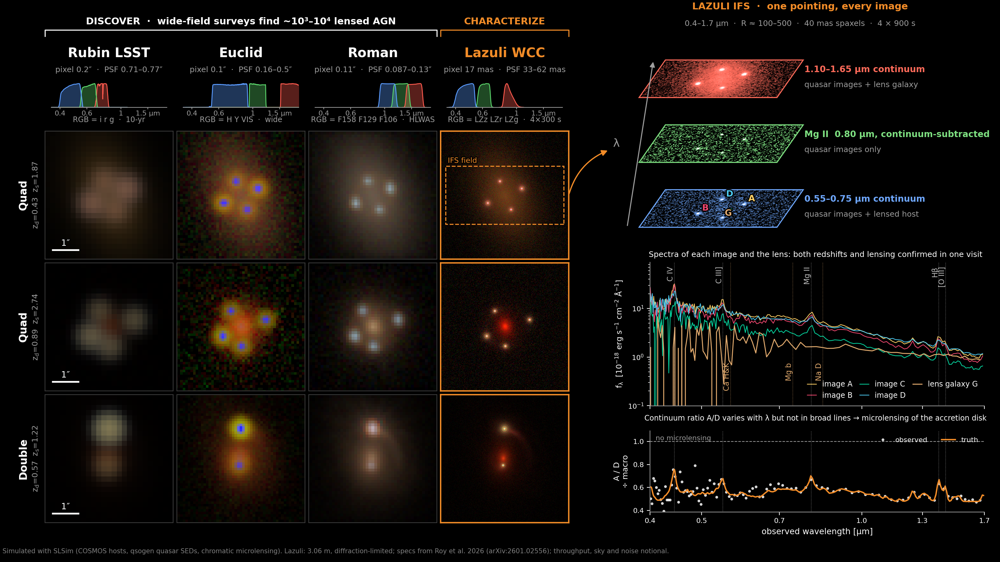

# Lensed AGN: discovery surveys vs. Lazuli follow-up

Slide figure contrasting how LSST, Euclid and Roman see lensed AGN with what
the Lazuli Space Observatory adds: diffraction-limited optical imaging (WCC)
and resolved 0.4–1.7 µm integral field spectroscopy of every lensed image.



## Run

```bash
python population.py   # SLSim lensed-AGN population with Lazuli bands -> cache/
python render.py       # images for all observatories + hero IFS cube -> cache/render.pkl
python figure.py       # figures/lazuli_lensed_agn.{png,pdf}
```

## Layout

- `observatories/lazuli.py` – Lazuli WCC imaging config for SLSim (17 mas pixels, Airy PSF)
- `ifs/` – IFS cube simulator built on SLSim's public API, no SLSim changes:
  - `instrument.py` Lazuli IFS model (R(λ), spaxels, throughput, sky, detector noise)
  - `spectra.py` qsogen quasar continuum and lines; kcorrect fits for the lens and host
  - `cube.py` morphology × spectrum per component, λ-dependent PSF, static chromatic microlensing
- `util.py`, `lens_io.py`, `skypy_config.py` – helpers copied from TDLDMC26 `sims/`

Lazuli specs come from Roy et al. 2026 (arXiv:2601.02556). Throughput curves,
sky, read noise and exposure times are notional.
